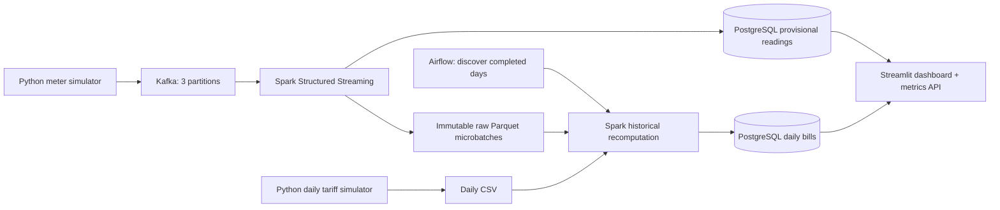

# GridPulse — Smart Grid Energy Monitoring and Daily Billing

An EC8203 mini-project implementing a **Lambda architecture** with Python simulators, Apache Kafka, Spark Structured Streaming, a historical Spark batch layer orchestrated by Airflow, PostgreSQL, and a Streamlit dashboard.

## Start on Windows

1. Start Docker Desktop and select Linux containers. Allow approximately **8 GB RAM** for this multi-service demo; actual needs depend on concurrent jobs. First startup downloads large images and Spark dependencies.
2. Open PowerShell in this project folder.
3. Run `powershell -ExecutionPolicy Bypass -File scripts/start.ps1`, or `docker compose up -d --build`.
4. Open **http://localhost:8501**. Live data appears once Spark has started. The first bill appears after a complete simulated day plus Airflow scheduling/processing time.

| Interface | URL | Credentials |
|---|---|---|
| Dashboard | http://localhost:8501 | None |
| Airflow | http://localhost:8080 | `admin` / `admin` |
| API documentation | http://localhost:8000/docs | None |
| Pipeline health | http://localhost:8000/health | None |
| Prometheus-format metrics | http://localhost:8000/metrics | None |

All published ports bind to your computer's loopback address. These are local demonstration credentials, not production authentication.

## Business question and scope

What is demand and solar contribution by grid zone right now, and what does each household owe once its daily tariff is applied? Fifty fictional households in three Colombo-labelled zones emit one interval reading every two real seconds. No real household or utility data is used.

The generator advances a deterministic simulated clock: **150 ticks = one simulated day = approximately 300 real seconds while running normally**. A tick represents 576 simulated seconds. Backpressure, pauses and restarts can lengthen a simulated day in wall-clock time. The clock pauses with the meter producer; it is not derived independently in other services. UTC labels are simulation coordinates, not Sri Lankan local time. The producer's committed tick in PostgreSQL is the source of truth for completed days.

The tariff simulator publishes an atomic CSV for each completed simulated day. Tariffs vary by date; every fifth household has a 20% subsidy. Values are a **simplified teaching model**, not current Sri Lankan utility tariffs. There are no batteries, export credits, taxes, fixed charges, or progressive billing tiers.

## Architecture



The speed layer cleans readings and derives solar self-consumption, grid imports and exports. The batch layer **re-reads raw history**, removes duplicate event IDs, aggregates each household/day, joins the dated tariff and publishes a complete daily snapshot. It does not merely total the speed-layer database. The serving layer displays provisional live figures and authoritative daily bills separately; they are never added together.

Airflow invokes a finite job on the internal `batch-worker` service over HTTP. That worker and the streaming service share one Spark image, avoiding duplicate Spark installations. Its port is not exposed to the host. A job lock prevents concurrent reconciliations, and a timeout terminates both the Python job and its JVM before a retry.

**Why Lambda:** a fast provisional view and repeatable historical billing have distinct latency and consistency needs. Historical recomputation also supports corrected tariffs. **Rejected alternative — Kappa:** it could publish tariff updates as events and replay retained readings through one processing path, but requires temporal reference-data joins and replay coordination. Lambda is easier to demonstrate here, at the cost of maintaining two paths. Shared validation/energy rules reduce divergence, but do not remove this maintenance trade-off.

## Correct units and billing

Readings are **energy during an interval**, in kWh, not power or cumulative meter values.

```
solar_used = min(consumption, solar_generation)
grid_import = max(consumption - solar_generation, 0)
solar_export = max(solar_generation - consumption, 0)
daily_bill = round(sum(interval_grid_import) * tariff * subsidy_factor, 2)
```

The subsidy factor is 0.8 or 1.0. Compute imports per interval before summing: exported midday energy must not cancel nighttime purchases in this model. Power charts convert each interval's energy to kW using `energy * 3600 / interval_seconds`. Solar contribution means self-consumed solar divided by demand; exported solar is not counted as supplying the same household's demand. No peer-to-peer solar allocation is modelled.

## Reliability and observability

- Kafka keys are household IDs, preserving per-household ordering within a partition. Three partitions demonstrate partitioning; replication factor one is a laptop simplification.
- Spark checkpoints and the raw archive share one persistent volume. Never remove one without resetting the corresponding pipeline state. Microbatch archive directories are published atomically before serving writes.
- Event IDs are unique database keys. Producer retries and Spark callback retries therefore do not inflate the serving store. Archive duplicates are removed before batch aggregation. This is idempotent sink behaviour, not a claim of a distributed transaction across Kafka, files and PostgreSQL.
- A daily reconciliation requires a tariff for every household and the expected interval count per household. Missing data produces a visible blocked job and Airflow retries; an earlier successful snapshot remains visible with its timestamp.
- Every minute, Airflow catches up older unprocessed days and revisits the last three completed days, processing at most three dates per task. Late data or tariff corrections in that window are picked up on a subsequent pass. Corrections to older already-completed dates require an explicit backfill.
- JSON logs contain stage, event and correlation information: source offsets, event IDs in payloads, microbatch IDs, and simulated dates. A rejected-event table preserves invalid payloads and reasons.
- Health rules: no valid arrivals for 30 real seconds; more than 5% rejected arrivals over 60 seconds; incomplete daily jobs. A separate dashboard business alert flags solar supplying less than 15% of demand between simulated 08:00 and 17:00.
- Metrics expose arrival age, accepted/rejected counts, error ratio and active alerts. Dashboard also shows stream heartbeat and microbatch duration. This is basic instrumentation, not a full distributed tracing deployment.

## Useful commands

```powershell
docker compose ps
docker compose logs --tail=50 stream
docker compose logs --tail=50 airflow-scheduler
docker compose exec airflow-scheduler airflow dags trigger gridpulse_daily_billing
docker compose exec airflow-scheduler python -m grid.remote_batch --day 2026-01-01
docker compose stop meters
docker compose start meters
docker compose stop
```

Stopping services retains their named volumes. Do not use `down --volumes` unless you intentionally want to erase all project data. A fresh simulation with different clock settings requires an intentional full data reset; changing settings mid-run would invalidate interval counts and IDs.

## Tests

The completed local verification passed **31 tests** and the full billing, rerun and outage-recovery acceptance check. See [the verification record](docs/VALIDATION.md) for measured results and evidence files.

Run `powershell -ExecutionPolicy Bypass -File scripts/test.ps1` after building images. This runs pure-rule/store tests and real Spark/Parquet integration tests inside the Spark image.

For faster host-side checks with Python 3.11:

```powershell
python -m venv .venv
.venv\Scripts\python -m pip install -r requirements.txt
.venv\Scripts\python -m pytest tests/test_domain.py tests/test_store.py tests/test_tariffs.py -q
```

Covered cases include energy conservation, surplus solar, no solar, day boundaries, subsidy/rounding, invalid readings, duplicate deliveries, stale arrivals, missing/invalid tariffs, Parquet recomputation, daily reruns and tariff correction. Spark integration tests are skipped on a host without PySpark; use the container command for the full suite.

For the full default 50-household acceptance check, run `python scripts/smoke_test.py` while the stack is running. It waits for daily bills, checks Airflow success, verifies an unchanged-source rerun, and temporarily stops/resumes this project's meters to verify alert recovery. It also pauses/resumes this project's scheduler to isolate the rerun. Results are saved in `output/smoke_result.json`.

## Project layout

For an optional **dashboard-only offline preview**, install the host dependencies and run `powershell -ExecutionPolicy Bypass -File scripts/preview.ps1`. It uses a separate SQLite fixture at `data/preview.db` and port 8502. Its visible banner identifies it as saved sample data; it does not verify or replace Kafka, Spark or Airflow.

| Path | Purpose |
|---|---|
| `grid/domain.py` | Deterministic readings and pure business rules |
| `grid/simulators.py` | Continuous meter source and daily tariff source |
| `grid/stream.py` | Kafka ingestion, Parquet archive and speed-layer sink |
| `grid/spark_common.py` | Shared Spark transformations |
| `grid/batch.py` | Historical aggregation and dated tariff join |
| `grid/batch_service.py`, `grid/remote_batch.py` | Internal finite-job endpoint and Airflow client |
| `grid/store.py` | Tables, idempotent writes and health rules |
| `dags/daily_billing.py` | Airflow schedule, retries and task timeout |
| `dashboard/app.py` | Live energy, daily billing and health pages |
| `grid/api.py` | Read-only live/billing/metrics endpoints |
| `tests/` | Business-rule and integration checks |
| `docs/` | Report material, demo script and project decisions |

## Troubleshooting

- **Docker cannot connect:** start Docker Desktop and wait for its Linux engine. In Windows, `docker context ls` should show `desktop-linux` selected.
- **First build is slow:** Java, Spark, Airflow and Kafka are substantial downloads. Maven access is needed for the Kafka connector during the Spark image build.
- **Dashboard is empty:** inspect `docker compose ps`, then `docker compose logs --tail=80 stream meters`. The first Spark microbatch has startup overhead.
- **No bills yet:** inspect the Pipeline health page and Airflow task log. A full day's readings and its tariff file must both be available. Initial backlogs can delay the first complete result.
- **Port already in use:** change only the host-side port in `compose.yaml`.
- **Memory pressure:** close other workloads or increase Docker memory; Spark streaming and a batch job run concurrently.

## Limits and production extensions

Single broker, local Spark, a shared filesystem, driver-side bounded collection, full archive scans and one PostgreSQL instance are deliberate demo limits. Production would need replicated Kafka, distributed Spark, partitioned object storage, scalable bulk writes, stronger schema contracts, explicit event corrections, proper secrets/authentication, backups and more complete metrics/tracing. The archive accepts immutable event identities; conflicting payloads for the same event ID are outside the simulator contract. Different source timestamps/interval boundaries would require more sophisticated billing attribution.

## Report and submission archive

The editable report is `docs/REPORT.md`; its rendered copy is `output/pdf/GridPulse_Report.pdf`. To regenerate it, install `requirements-report.txt` and run `python scripts/build_report.py`. Evidence is read from `output/validation.json`, and dashboard captures from `output/screenshots/`. Keep the evidence labels accurate when replacing screenshots.

Run `python scripts/package_project.py` to create `output/GridPulse_Submission.zip`. It includes source, documentation, report and available verification evidence, excluding virtual environments, databases and Docker data. Add student details and actual contribution statements before submission.

## References

- Brief: *EC8203 MiniProject 2026*, supplied course document.
- [Spark Kafka integration](https://spark.apache.org/docs/3.5.7/structured-streaming-kafka-integration.html)
- [Spark Structured Streaming guide](https://spark.apache.org/docs/3.5.7/structured-streaming-programming-guide.html)
- [Airflow Docker setup](https://airflow.apache.org/docs/apache-airflow/2.10.5/howto/docker-compose/index.html)
- [Apache Kafka container](https://hub.docker.com/r/apache/kafka)

Students should review and understand all core logic and complete their names/contribution statement before submission, as required by the brief.
